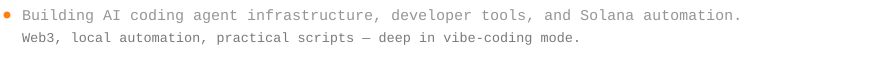

# Blackterminal

![Codex](https://img.shields.io/badge/-Codex-1F1F1F?style=flat-square&logo=data:image/svg+xml;base64,PHN2ZyB4bWxucz0iaHR0cDovL3d3dy53My5vcmcvMjAwMC9zdmciIHZpZXdCb3g9IjAgMCAyNCAyNCIgZmlsbD0iI0ZGN0YwRSI+PHBhdGggZD0iTTIyLjI4MiA5LjgyMWE1Ljk4NSA1Ljk4NSAwIDAgMC0uNTE2LTQuOTEgNi4wNDYgNi4wNDYgMCAwIDAtNi41MS0yLjlBNi4wNjUgNi4wNjUgMCAwIDAgNC45ODEgNC4xOGE1Ljk4NSA1Ljk4NSAwIDAgMC0zLjk5OCAyLjkgNi4wNDYgNi4wNDYgMCAwIDAgLjc0MyA3LjA5NyA1Ljk4IDUuOTggMCAwIDAgLjUxIDQuOTExIDYuMDUxIDYuMDUxIDAgMCAwIDYuNTE1IDIuOUE1Ljk4NSA1Ljk4NSAwIDAgMCAxMy4yNiAyNGE2LjA1NiA2LjA1NiAwIDAgMCA1Ljc3Mi00LjIwNiA1Ljk5IDUuOTkgMCAwIDAgMy45OTctMi45IDYuMDU2IDYuMDU2IDAgMCAwLS43NDctNy4wNzN6TTEzLjI2IDIyLjQzYTQuNDc2IDQuNDc2IDAgMCAxLTIuODc2LTEuMDRsLjE0MS0uMDgxIDQuNzc5LTIuNzU4YS43OTUuNzk1IDAgMCAwIC4zOTItLjY4MXYtNi43MzdsMi4wMiAxLjE2OGEuMDcxLjA3MSAwIDAgMSAuMDM4LjA1MnY1LjU4M2E0LjUwNCA0LjUwNCAwIDAgMS00LjQ5NCA0LjQ5NHpNMy42IDE4LjMwNGE0LjQ3IDQuNDcgMCAwIDEtLjUzNS0zLjAxNGwuMTQyLjA4NSA0Ljc4MyAyLjc1OWEuNzcxLjc3MSAwIDAgMCAuNzggMGw1Ljg0My0zLjM2OXYyLjMzMmEuMDguMDggMCAwIDEtLjAzMy4wNjJMOS43NCAxOS45NWE0LjUgNC41IDAgMCAxLTYuMTQtMS42NDZ6TTIuMzQgNy44OTZhNC40ODUgNC40ODUgMCAwIDEgMi4zNjYtMS45NzNWMTEuNmEuNzY2Ljc2NiAwIDAgMCAuMzg4LjY3Nmw1LjgxNSAzLjM1NS0yLjAyIDEuMTY4YS4wNzYuMDc2IDAgMCAxLS4wNzEgMGwtNC44My0yLjc4NkE0LjUwNCA0LjUwNCAwIDAgMSAyLjM0IDcuODcyem0xNi41OTcgMy44NTVsLTUuODMzLTMuMzg3TDE1LjExOSA3LjJhLjA3Ni4wNzYgMCAwIDEgLjA3MSAwbDQuODMgMi43OTFhNC40OTQgNC40OTQgMCAwIDEtLjY3NiA4LjEwNXYtNS42NzhhLjc5Ljc5IDAgMCAwLS40MDctLjY2N3ptMi4wMS0zLjAyM2wtLjE0MS0uMDg1LTQuNzc0LTIuNzgyYS43NzYuNzc2IDAgMCAwLS43ODUgMEw5LjQwOSA5LjIzVjYuODk3YS4wNjYuMDY2IDAgMCAxIC4wMjgtLjA2MWw0LjgzLTIuNzg3YTQuNSA0LjUgMCAwIDEgNi42OCA0LjY2em0tMTIuNjQgNC4xMzVsLTIuMDItMS4xNjRhLjA4LjA4IDAgMCAxLS4wMzgtLjA1N1Y2LjA3NWE0LjUgNC41IDAgMCAxIDcuMzc1LTMuNDUzbC0uMTQyLjA4TDguNzA0IDUuNDZhLjc5NS43OTUgMCAwIDAtLjM5My42ODF6bTEuMDk3LTIuMzY1bDIuNjAyLTEuNSAyLjYwNyAxLjV2Mi45OTlsLTIuNTk3IDEuNS0yLjYwNy0xLjV6Ii8+PC9zdmc+)

<h2></h2>

<!-- GitHub contributions merged with local Codex turns and commits (counts only), rendered by scripts/contrib_heatmap.py. Refreshed hourly from the Mac that runs this repo, and weekly by .github/workflows/activity-graph.yml. Live fallback: https://github-profile-summary-cards.vercel.app/api/cards/profile-details?username=subkoks&theme=gruvbox&bg_color=000000&title_color=FF7F0E&icon_color=FF7F0E&text_color=E6E6E6 -->

<h2></h2>

- **[agents-md](https://github.com/subkoks/agents-md)** — Cross-editor agent operating system on the GOTCHA framework: a Solana / web3 skill pack, drift-checked rule builds, runtime automation, and `make install-*` flows.
- **[BSELA](https://github.com/subkoks/BEST-Self-Enhancement-Learning-AI)** — Local control plane that learns from coding-AI sessions: captures context, detects failures, distills lessons, and proposes `AGENTS.md` updates. Six-tool MCP server, drift alarms, rollback.
- **[BoardVault](https://github.com/subkoks/apple-all-schematic)** — macOS desktop app and CLI that downloads and organizes Apple-device schematics and boardviews from public Telegram channels. Native SwiftUI interface now shipping beside the Qt build.
- **[BiQuadMonitor](https://github.com/subkoks/BiQuadMonitor)** — Native macOS menu-bar monitor for supported Cudy cellular routers: live SINR / RSRQ / RSRP / RSSI, antenna trial logging, saved measurement history. Unsigned Universal release.
- **[hacker-agent](https://github.com/subkoks/hacker-agent)** — Permanent-memory security research and reverse-engineering toolkit: SQLite memory, CVE / CISA KEV feeds, audit checklists, Ghidra MCP catalog, Stake Engine math helpers (Python 3.13 + `uv`).
- **[SolanaIdeasLab](https://github.com/subkoks/SolanaIdeasLab)** — Solana market research, architecture, and a master plan, with trading bots and scanners taking shape in **[SolanaIdeasLab-projects](https://github.com/subkoks/SolanaIdeasLab-projects)**.

<h2></h2>

###  AI coding agents &amp; infrastructure

- **[agents-md](https://github.com/subkoks/agents-md)** · `Shell`  — Canonical cross-editor agent OS on the GOTCHA framework. Crypto/web3/Solana skill pack, drift-checked rule builds, production-grade scaffolding.
- **[BEST-Self-Enhancement-Learning-AI](https://github.com/subkoks/BEST-Self-Enhancement-Learning-AI)** (BSELA) · `Python`  — Local control plane that learns from coding-AI sessions: capture → detect errors → distill lessons → propose `AGENTS.md` updates. Six-tool MCP server, drift alarms, rollback.
- **multi-agent-system-architecture-codex** — Multi-agent and loop architecture for the BLACK.TERMINAL Codex setup: planner, governor and builder agents, skill discovery, reversible installer. Private repo.

###  Security &amp; agent defense

- **[hacker-agent](https://github.com/subkoks/hacker-agent)** · `Python`  — Permanent-memory security research and reverse-engineering toolkit: SQLite memory, CVE / CISA KEV feeds, audit checklists, Ghidra MCP catalog, Stake Engine math helpers.
- **[blackterminal-security](https://github.com/subkoks/blackterminal-security)** · `Shell` — Senior security-engineer instincts for AI coding agents: OWASP Top 10, CWE Top 25, secrets detection, IaC/CI hardening + read-only auditor agent. MIT.
- **[prompt-injection-security](https://github.com/subkoks/prompt-injection-security)** · `Shell` — Prompt-injection defense for agent workflows: skeptical-reading skill, audit command, read-only auditor agent, offline scanner.

###  Solana &amp; web3

- **[SolanaIdeasLab](https://github.com/subkoks/SolanaIdeasLab)** · `Shell` — Market research, architecture docs, ideas tiers, and the master plan.
- **[SolanaIdeasLab-projects](https://github.com/subkoks/SolanaIdeasLab-projects)** · `TypeScript` — Companion code: token-safety-bot, token-sniper-bot, wallet-tracker-pro, shared utilities.

###  Native macOS apps

- **[BoardVault](https://github.com/subkoks/apple-all-schematic)** · `Python`  — Apple schematic and boardview downloader: macOS desktop app (native SwiftUI, Qt 2.0 alongside) and CLI, sourcing from public Telegram channels.
- **[BiQuadMonitor](https://github.com/subkoks/BiQuadMonitor)** · `Swift` — Menu-bar monitor and antenna experiment workspace for supported Cudy routers: live radio metrics, trial logging, saved measurements.

###  Automation &amp; tools

- **[stake-mirrors-ping](https://github.com/subkoks/stake-mirrors-ping)** · `Python` — Finds the fastest Stake.com mirror and the optimal NordVPN region for lowest latency.
- **[about-me](https://github.com/subkoks/about-me)** · Extended about page — projects, stack, and links.

<h2></h2>

<!-- Add blog / site badge here when black.terminal is live -->

